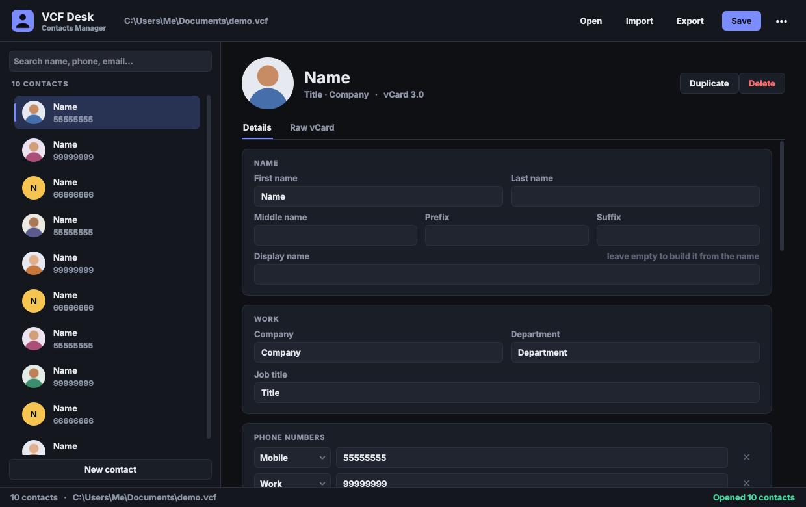
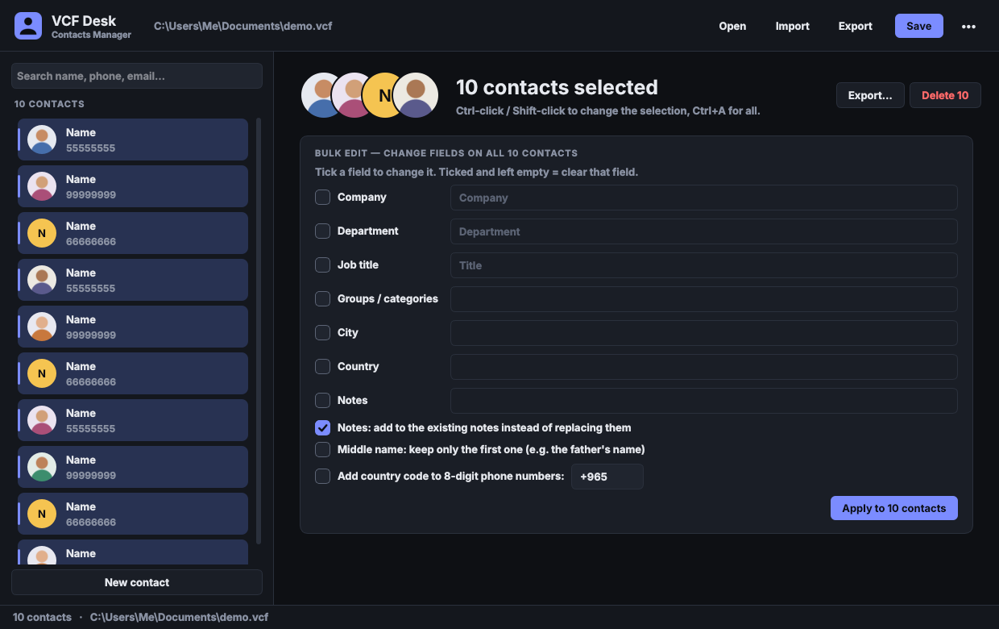
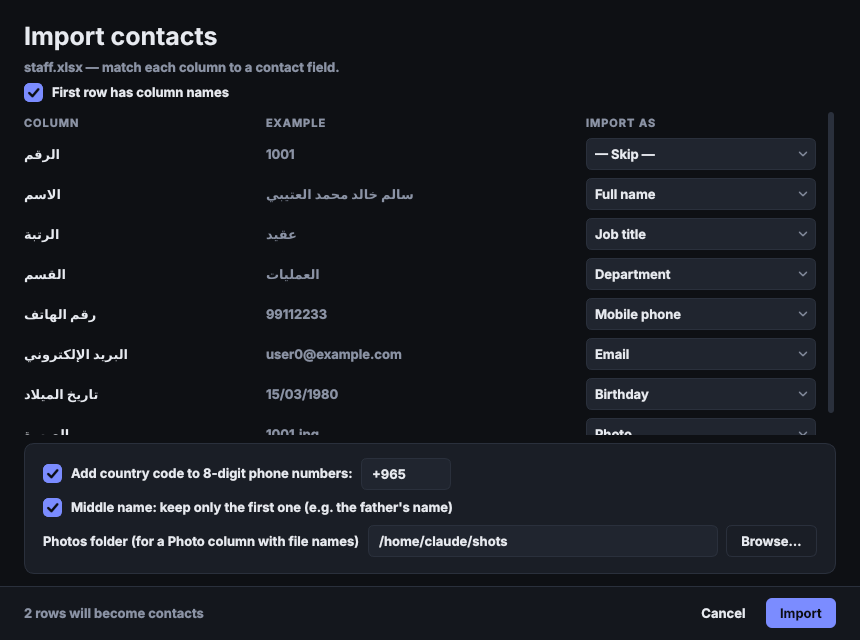
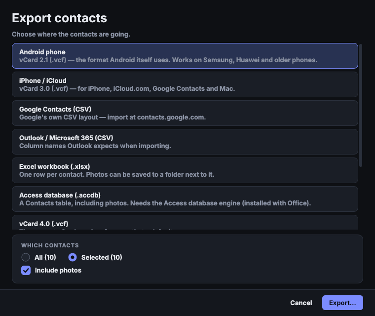
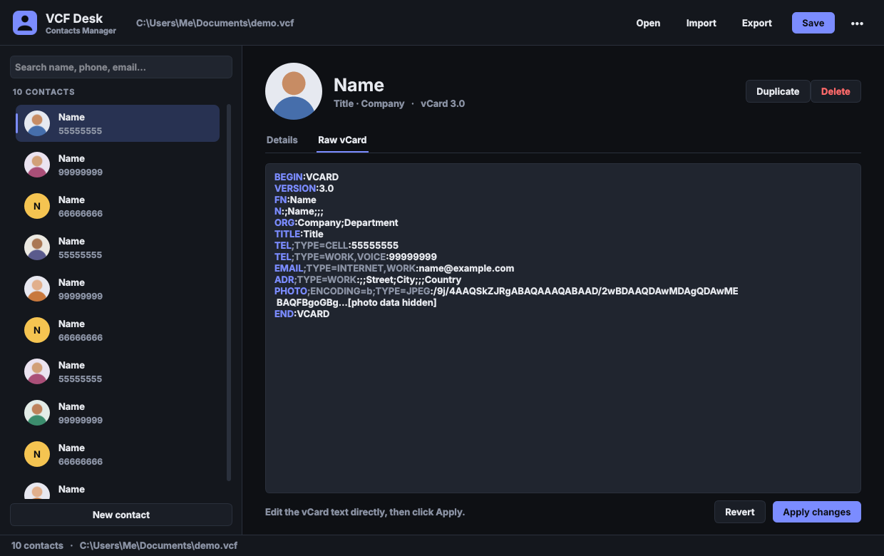

<p align="center">
  
</p>

<h1 align="center">VCF Desk</h1>

<p align="center">
  <b>Contacts Manager for Windows.</b><br>
  A free, modern vCard (.vcf) editor. Open your phone's contacts, fix them, and send them anywhere. Your contacts stay on your PC.
</p>

<p align="center">
  <a href="../../releases/latest"></a>
  <a href="../../releases/latest"></a>
  
  <a href="LICENSE"></a>
  <a href="../../stargazers"></a>
</p>

<p align="center">
  <a href="https://github.com/ilukezippo/VCF-Desk/releases/download/v1.0/VCF-Desk-Setup-1.0.exe"></a>
</p>

<p align="center">
  <a href="https://github.com/ilukezippo/VCF-Desk/releases/download/v1.0/VCF-Desk-Android-1.0.apk"></a>
</p>

<p align="center">
  <sub>Downloads the latest installer straight away. Prefer no install? Get <a href="https://github.com/ilukezippo/VCF-Desk/releases/download/v1.0/VCF-Desk-Portable-1.0.zip">the portable ZIP</a>.</sub>
</p>

<p align="center">
  <a href="../../releases/latest">All downloads</a> ·
  <a href="#how-to-use">How to use</a> ·
  <a href="#android">Android</a> ·
  <a href="CHANGELOG.md">What's new</a> ·
  <a href="#import-and-export">Formats</a> ·
  <a href="#build-from-source">Build</a>
</p>



<p align="center"><sub>If VCF Desk saves you time, a ⭐ star on this page helps other people find it.</sub></p>

---

## Why

Phones export contacts as `.vcf` files, but Windows has nothing good to open them with. The free editors are either ad-supported or look like they're from 2005, and most of them quietly drop the fields they don't understand, or garble Arabic names. VCF Desk opens any vCard, shows every contact with its photo, lets you fix and bulk-edit them, and writes them back out for Android, iPhone, Google, Outlook, Excel or Access, without losing anything.

## How to use

1. **Open** a `.vcf` file (or drop it on the window). Exports from Android, iPhone, Google Contacts, Outlook and Samsung all work.
2. Click a contact to edit it. Changes are applied as you type; **Ctrl+Z** undoes them.
3. **Save** (Ctrl+S) writes the file back, or **Export** (Ctrl+E) sends the contacts to another format.

| Do this | You get |
|---|---|
| Type in the search box (**Ctrl+F**) | Contacts matching a name, phone number (spaces don't matter) or email |
| **Ctrl-click**, **Shift-click** or **Ctrl+A** in the list | Several contacts selected: bulk-edit, export or delete them together |
| **Import** (Ctrl+I) | Add contacts from another vCard, an Excel sheet, a CSV file or an Access database |
| **Raw vCard** tab | The contact's vCard text, to edit any field directly |
| Click a contact's photo | The photo at full size, with *Save image…* |
| **⋯** menu | Save as, sort A → Z, remove duplicates, new file |

Fields VCF Desk doesn't show (Android extras, iPhone custom labels, groups, UIDs…) are **kept exactly as they were** when you save.

<table>
  <tr>
    <td></td>
    <td></td>
  </tr>
  <tr>
    <td align="center">Bulk edit: change a field on many contacts at once</td>
    <td align="center">Import from Excel, CSV or Access, with Arabic headings matched automatically</td>
  </tr>
  <tr>
    <td></td>
    <td></td>
  </tr>
  <tr>
    <td align="center">Export for Android, iPhone, Google, Outlook, Excel or Access</td>
    <td align="center">Raw vCard view for any field</td>
  </tr>
</table>

## Android

VCF Desk also runs on Android phones and foldables (Android 8 and newer). It is the same idea as the Windows app: fix your contacts, change many at once, and never lose a field the app doesn't show.

- **Your phone's contacts or your Google contacts:** pick the source inside the app. Phone contacts never leave the phone
- **Bulk edit with a safety net:** change a field on many contacts, see a preview first, and every run is backed up so it can be undone
- **Import and export:** vCard, Excel and CSV in; vCard, Google CSV, Outlook CSV and Excel out
- **Arabic and photos handled properly,** and a two-pane list and editor on an unfolded Galaxy Z Fold or a tablet

Screenshots are coming soon.

### Install

1. **[Download the APK](https://github.com/ilukezippo/VCF-Desk/releases/download/v1.0/VCF-Desk-Android-1.0.apk)** on your phone.
2. Open it from your browser's downloads or the Files app. Android asks you to **allow installing apps from this source** (your browser or Files): allow it, go back, and tap *Install*.
3. Google Play Protect may say the app comes from outside the store. Choose **Install anyway**; the app is signed and open source.

### Google contacts

No sign-in needed. The app edits the contacts of the **Google accounts already on your phone**, and Android syncs every change to [Google Contacts](https://contacts.google.com) by itself. To edit another Google account, tap **Add Google account to this phone**. If contacts sync is off for an account, the app shows a banner with a **Turn on** button.

### Android limits

- Google accounts must be added to the phone to be edited
- **Org units** (department parts of a company) are not stored in Google contacts
- Excel files can't hold very large photos; use vCard to keep them

## Features

- **Reads every vCard:** versions 2.1, 3.0 and 4.0, quoted-printable and UTF-8, folded lines, iPhone `itemN.` labels, embedded and linked photos
- **Arabic done right:** names read right to left, old Android quoted-printable Arabic is decoded, Excel exports open right to left, and CSV files keep their Arabic in Excel
- **Photos** in the list and the editor, full-size preview, save the picture out, add or change one. Decoded in the background, so files with hundreds of photos stay smooth
- **Bulk edit:** company, department, job title, groups, city, country and notes on many contacts at once; keep only the first middle name; add a country code (+965 by default) to 8-digit numbers
- **Import from Excel, CSV and Access** with automatic column matching (English and Arabic headings), full-name splitting that keeps names like *عبد الله* together, photos from a folder or from the database itself
- **Export** to Android, iPhone/iCloud, vCard 4.0, Google Contacts CSV, Outlook CSV, Excel, plain CSV, Access, or one file per contact; all contacts, the search results or the selection
- **Tidy up:** search, duplicate, delete, sort A → Z, remove exact duplicates
- **Undo everywhere** and shortcuts that also work with the Arabic keyboard layout
- **Drag and drop** `.vcf`, `.xlsx`, `.csv`, `.accdb` and `.mdb` files anywhere on the window
- **100% offline.** No accounts, no telemetry, no internet connections at all (see the [privacy policy](PRIVACY.md))

## Import and export

| | Opens / imports | Exports |
|---|---|---|
| **vCard** | `.vcf` / `.vcard` 2.1, 3.0, 4.0 | **Android phone** (2.1, the format Android writes), **iPhone / iCloud** (3.0), **vCard 4.0**, one `.vcf` per contact |
| **Google Contacts** | its CSV export | CSV in Google's import layout |
| **Outlook / Microsoft 365** | its CSV export | CSV with the column names Outlook expects |
| **Excel** | `.xlsx`, `.xlsm` (any sheet) | `.xlsx` with a header row, filters and frozen top row; photos saved to a folder next to it |
| **CSV** | any delimiter, UTF-8 or Windows Arabic | UTF-8 CSV that opens in Excel with Arabic intact |
| **Microsoft Access** | `.accdb`, `.mdb` (any table, photos in OLE fields too) | `.accdb` with a *Contacts* table, including photos |

Saving keeps a vCard 4.0 file as 4.0 and writes everything else as vCard 3.0 (UTF-8), which every current phone and service reads.

**Access:** importing works on any PC (VCF Desk has its own reader). Exporting to Access uses the **64-bit Microsoft Access database engine**, which comes with 64-bit Office, or free as the *Microsoft Access Database Engine 2016 Redistributable*.

## Install

1. **[Download the installer](https://github.com/ilukezippo/VCF-Desk/releases/download/v1.0/VCF-Desk-Setup-1.0.exe)** (the latest version), or pick a file on the [Releases](../../releases/latest) page.
2. Run it. It asks for administrator rights and installs for all users into `C:\Program Files\VCF Desk`.
3. Choose your options: desktop shortcut, and *Open .vcf files with VCF Desk*. The installer speaks English and Arabic.

Prefer no install? Unzip **VCF-Desk-Portable-1.0.zip** anywhere and run `VCF Desk.exe`. Python is not needed either way.

To remove it, use **Settings → Apps** or *Uninstall* in the Start menu.

> The installer is not code-signed yet, so Windows may warn about it:
>
> - **Microsoft Edge** may hold the download ("isn't commonly downloaded"): open the downloads list, point at the file, choose **… → Keep**, then **Show more → Keep anyway**.
> - **SmartScreen** may warn when you run it: choose **More info → Run anyway**.

**Requirements:** Windows 10 or 11, 64-bit.

## Build from source

You need Python 3.12 (64-bit).

```bat
git clone https://github.com/ilukezippo/VCF-Desk.git
cd VCF-Desk
run.bat      :: first run creates a .venv, installs dependencies, starts VCF Desk
build.bat    :: builds dist\VCF Desk\VCF Desk.exe, plus the installer if NSIS is installed
```

To get NSIS for the installer: `winget install NSIS.NSIS`.

Every push to `main` builds the installer and a portable zip with GitHub Actions and publishes them as release `v<VERSION>` (the `APP_VERSION` in `VCF_Desk.pyw`). Bump the version to publish a new release.

### Project layout

```
VCF_Desk.pyw    the app (PySide6 / Qt): list, editor, bulk edit, import and export dialogs
vcf_core.py     everything that isn't UI: vCard read/write, Excel/CSV/Access import, all exports
installer/      NSIS installer script and artwork
tests/          tests for the core and the app (run with: python -m pytest tests)
```

`vcf_core.py` works without the app:

```python
import vcf_core as v
contacts = v.read_vcf_file("contacts.vcf")
v.write_vcf_file("for-android.vcf", contacts, "2.1")   # Android
v.write_google_csv("google.csv", contacts)             # Google Contacts
v.write_excel("contacts.xlsx", contacts)               # Excel
```

## How it works

- Every property of every card is kept as it was read. The editor only rewrites the fields it shows, in place, so unknown fields and their order survive a save.
- Text is unescaped and re-escaped per vCard version; quoted-printable (vCard 2.1) is decoded on read and written again only for the Android export.
- Photos are decoded with Qt's image readers on background threads, scaled while decoding, and cached.
- Excel files are read and written directly (they're zip files of XML), so no Office is needed. Access files are read through the Access ODBC driver when it's there, otherwise with the pure-Python [access-parser](https://github.com/claroty/access-parser).

## Known limits

- Old binary Excel files (`.xls`) can't be read: open them in Excel and use *Save As → Excel Workbook (.xlsx)*.
- Exporting to Access needs the 64-bit Access database engine (see above).

## License

[MIT](LICENSE) © ilukezippo
